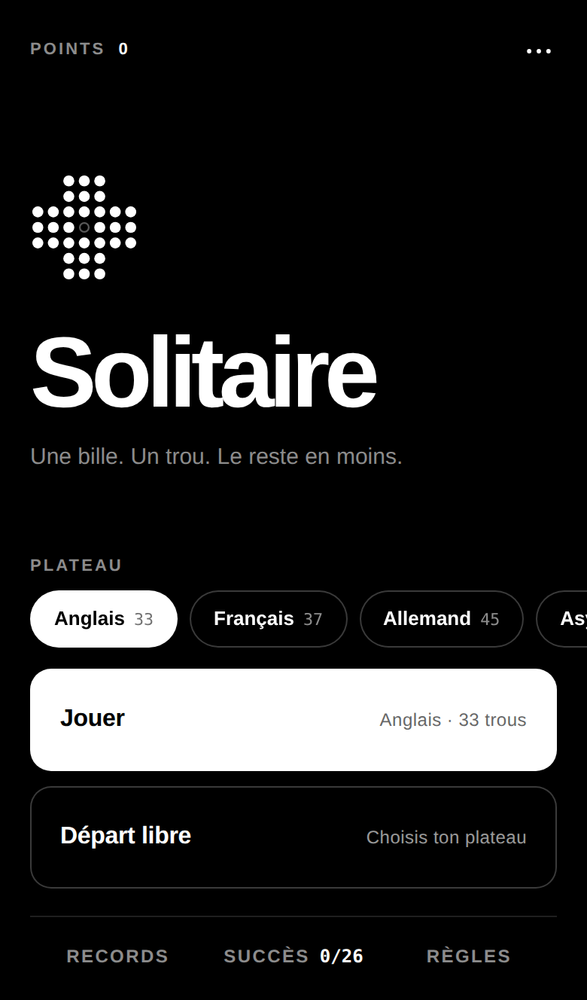
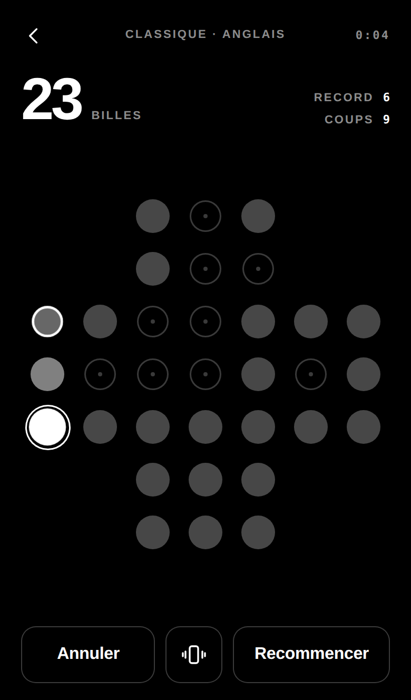
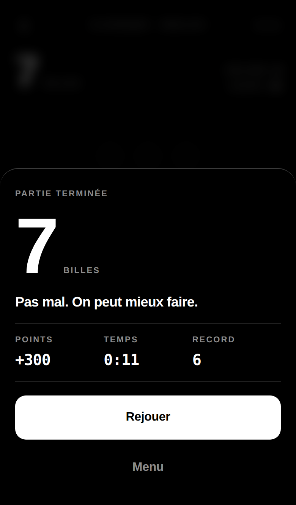
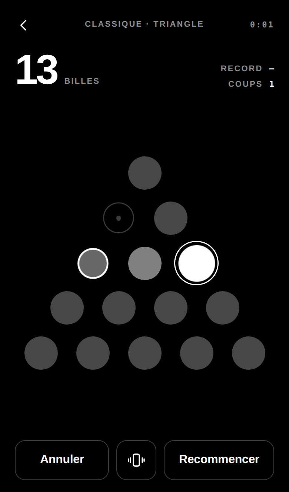
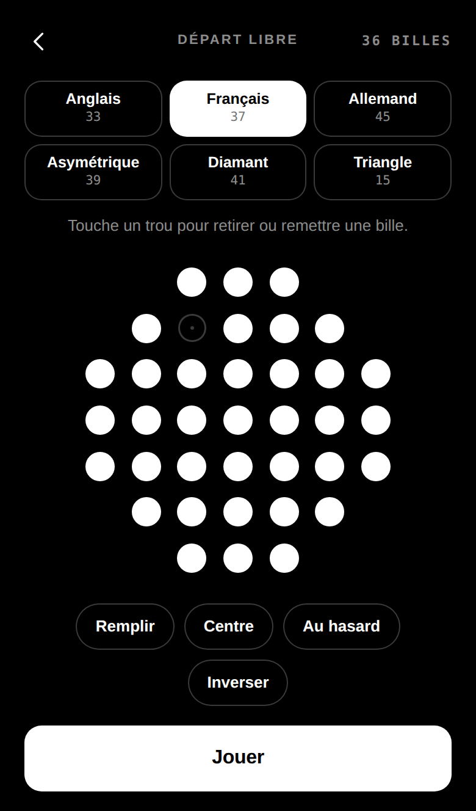
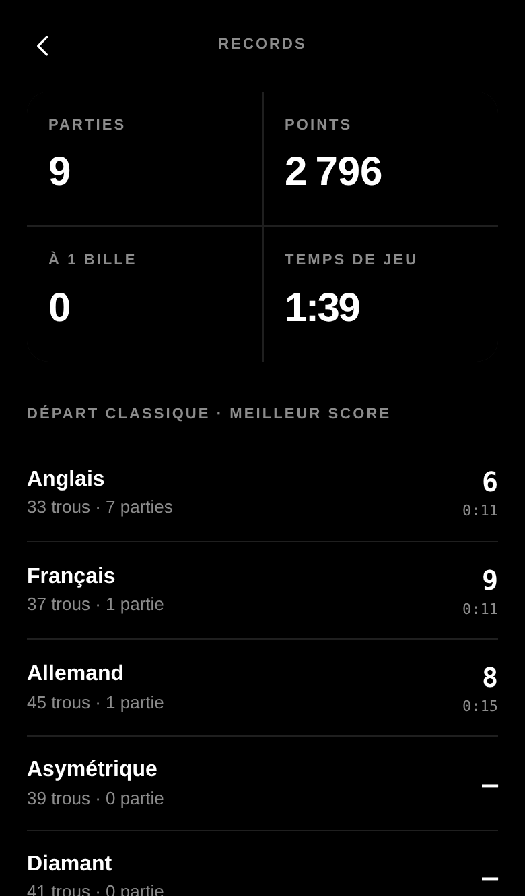
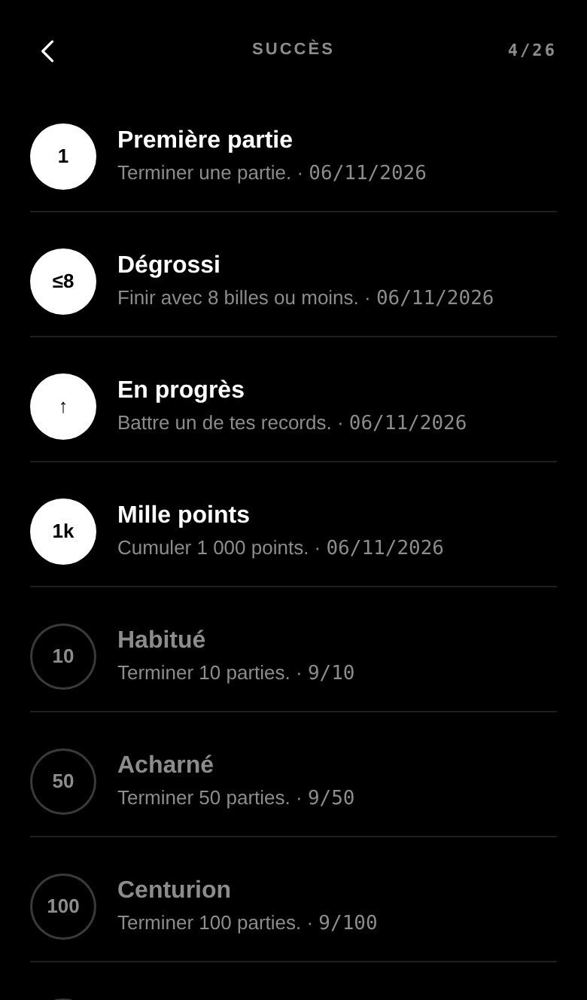
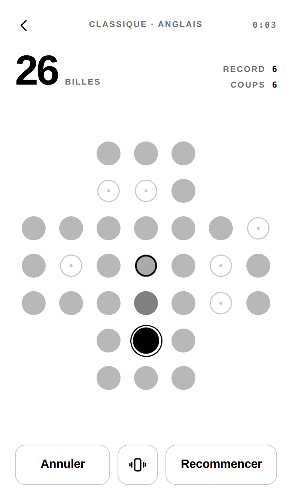
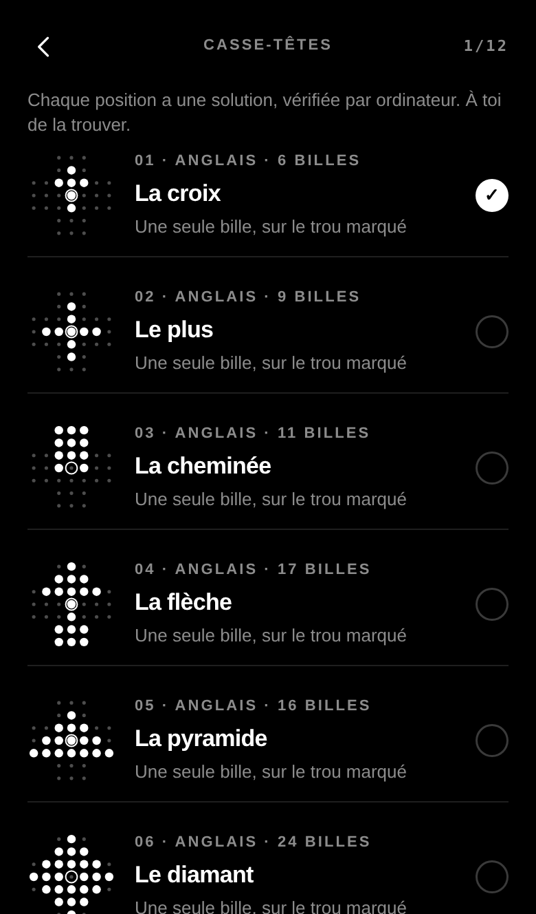
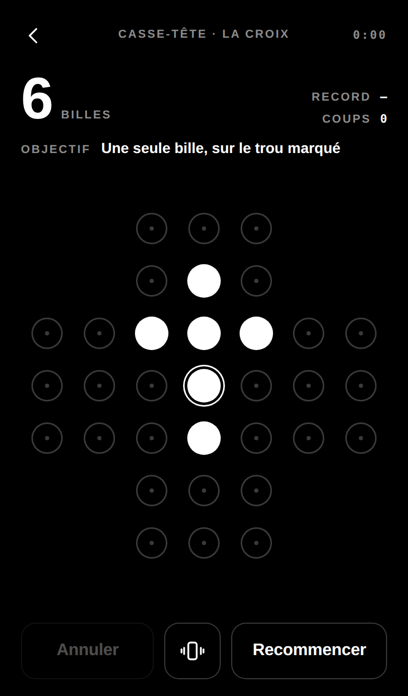

# Solitary — solitaire à billes

Un solitaire à billes en **PWA**, minimaliste en noir et blanc, pensé pour le mobile et jouable **hors connexion**.

**▶ Jouer : [solitaireabille.duckdns.org](https://solitaireabille.duckdns.org)**
Sur iPhone : Partager → *Sur l'écran d'accueil*. Sur Android : menu → *Installer l'application*.

<p align="center">
  
  
  
  
</p>
<p align="center">
  
  
  
  
</p>
<p align="center">
  
  
</p>

## Règles

Une bille saute **par-dessus une bille voisine**, horizontalement ou verticalement, pour atterrir dans un **trou vide** juste derrière. La bille sautée est retirée. La partie s'arrête quand plus aucun saut n'est possible : le score est le **nombre de billes restantes**. Une seule bille, c'est gagné, et au centre, c'est parfait.

## Plateaux

| Plateau | Trous | Départ classique | Meilleur résultat possible |
|---|---|---|---|
| **Anglais** (par défaut) | 33 | centre vide | 1 bille |
| Français | 37 | centre vide | 2 billes |
| Allemand | 45 | centre vide | — |
| Asymétrique | 39 | centre vide | 1 bille |
| Diamant | 41 | centre vide | — |
| Triangle | 15 | sommet vide, sauts dans 6 directions | 1 bille |

Les résultats indiqués ont été vérifiés avec un solveur.

## Fonctionnalités

- **Mode Classique** sur le plateau choisi, et **Départ libre** : on compose n'importe quelle position de départ, et chaque position a son propre record.
- Au toucher : bille puis trou. Les **coups possibles clignotent**, la zone de toucher est élargie, et on peut aussi **faire glisser** la bille.
- **Retour haptique** sur Android (`navigator.vibrate`) et sur iPhone, via un interrupteur natif `<input switch>`, seul moyen pour une page web de faire vibrer un iPhone. Un bouton dans la partie l'active ou le désactive.
- **12 casse-têtes** avec objectif (une bille sur le trou marqué, une bille n'importe où, N billes ou moins), tous **prouvés résolubles** par `tools/verify-puzzles.mjs` : recherche exhaustive, puis chaque solution est rejouée dans le moteur du jeu.
- **Points, records, statistiques, 29 succès**, tous stockés **localement sur le téléphone** (IndexedDB). Rien n'est envoyé à un serveur. Export et import en JSON.
- Annuler, chrono, reprise de la partie en cours, thème clair.
- **Hors connexion** grâce à un service worker.

## Technique

Du HTML, du CSS et du JavaScript (modules ES) sans framework, sans dépendance et sans étape de build.

```
index.html            écrans et structure
style.css             thème noir & blanc, mobile first
app.js                interface, entrées tactiles, haptique, stats, succès
game.js               logique pure : plateaux, coups, score
db.js                 stockage local IndexedDB
achievements.js       définition des succès
puzzles.js            casse-têtes et objectifs
tools/verify-puzzles.mjs  preuve que chaque casse-tête est résoluble
sw.js                 cache hors-ligne
manifest.webmanifest  installation PWA
```

### Lancer en local

```bash
python3 -m http.server 8000
# puis http://localhost:8000
```

### Vérifier les casse-têtes

```bash
node tools/verify-puzzles.mjs
```

### Déployer

Il suffit de servir le dossier comme un site statique en HTTPS (le HTTPS est obligatoire pour le service worker). `deploy-root.sh` installe le site sur un VPS nginx et obtient le certificat avec certbot.
À chaque mise à jour, **incrémenter `VERSION` dans `sw.js`** pour que les téléphones récupèrent la nouvelle version.
